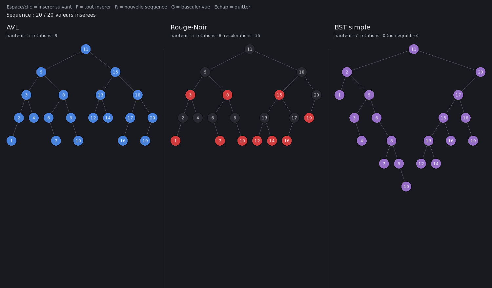
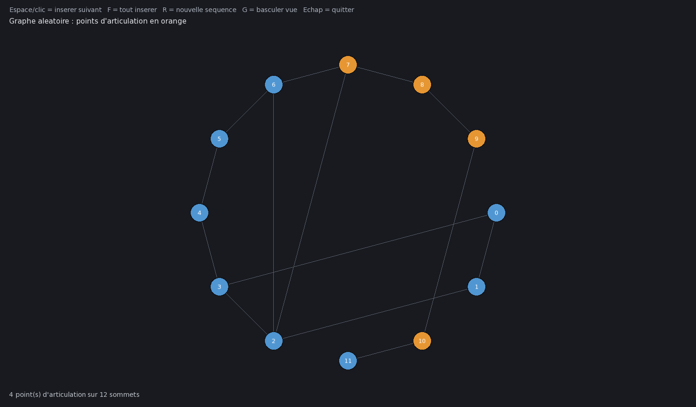

# Visualiseur de structures de données — AVL vs rouge-noir vs BST

Un petit programme C++/SFML qui insère la **même séquence aléatoire**,
une valeur à la fois, dans trois arbres différents et les dessine côte
à côte, pour rendre visible ce qui change réellement entre leurs
stratégies d'équilibrage.



## Le concept

Trois structures reçoivent exactement les mêmes 20 valeurs, dans le
même ordre :

- **AVL** (`arbreavl.h`) — s'équilibre en comparant la hauteur des deux
  sous-arbres de chaque nœud (facteur d'équilibre -1/0/1) et corrige
  par rotation dès que ça déborde.
- **Rouge-noir** (`arbrerougenoir.h`, écrit pour ce projet) — s'équilibre
  via une règle de coloration (jamais deux nœuds rouges d'affilée, même
  nombre de nœuds noirs sur tout chemin racine→feuille) et corrige par
  recoloration ou rotation.
- **BST simple** (`arbrebst.h`) — aucun équilibrage du tout : sert de
  référence pour montrer ce qu'il se passe *sans* stratégie.

Chaque colonne affiche en direct sa **hauteur** et son **nombre de
rotations** (le rouge-noir affiche aussi ses recolorations). Sur
l'exemple ci-dessus : l'AVL et le rouge-noir restent à la même hauteur
(5) pour un coût d'équilibrage très différent (9 rotations pour l'AVL,
8 rotations + 36 recolorations pour le rouge-noir — la coloration est
"moins chère" qu'une rotation), alors que le BST grimpe à 7 sans jamais
se corriger.

Une seconde vue montre un graphe aléatoire séparé, avec ses **points
d'articulation** en orange (algorithme de Tarjan) — les sommets dont le
retrait couperait le graphe en plusieurs morceaux.



## Contrôles

| Touche | Effet |
| --- | --- |
| `Espace` ou clic gauche | Insère la prochaine valeur dans les 3 arbres en même temps |
| `F` | Insère toutes les valeurs restantes d'un coup |
| `R` | Recommence avec une nouvelle séquence aléatoire |
| `G` | Bascule entre la vue "arbres" et la vue "graphe" |
| `Échap` | Quitte |

## Installer et lancer

Le projet a besoin de **SFML 3** (l'API a changé entre SFML 2 et 3 ;
ce code utilise l'API de la version 3) :

```bash
# macOS
brew install sfml

# Linux (verifier que la version installee est bien >= 3 :
# pkg-config --modversion sfml-graphics)
sudo apt-get install libsfml-dev
```

Puis :

```bash
make
./visualiseur
```

Le Makefile utilise `pkg-config` pour trouver automatiquement les
chemins d'installation de SFML (y compris `/opt/homebrew` sur Mac Apple
Silicon) ; pas besoin de les configurer à la main.

## Lancer les tests (sans interface graphique)

La correction des trois structures (ordre, hauteur bornée, invariants
rouge-noir vérifiés exactement) est testée indépendamment de
l'affichage, sur des séquences connues et sur 50 séquences aléatoires :

```bash
make test
```

## Pourquoi ce projet existe

Ce projet reprend l'arbre AVL et le graphe du [showcase
d'algorithmes](../algo-showcase) et ajoute un arbre rouge-noir écrit
pour l'occasion, afin de comparer concrètement deux stratégies
d'équilibrage différentes plutôt que de les présenter séparément. SFML
sert ici uniquement à rendre visible, en temps réel, ce que chaque
structure fait à sa forme — pas pour en faire un jeu.

---

<sub>Conçu et implémenté avec l'assistance de Claude (Anthropic) : idées et choix de conception discutés et validés par moi, code écrit en collaboration, puis relu et compris en détail.</sub>
